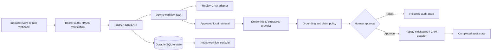
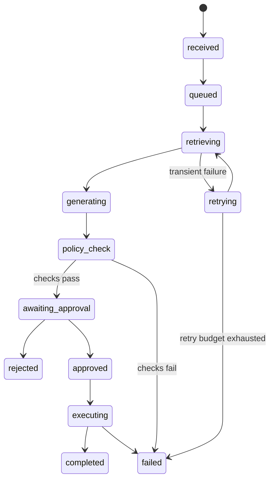

# Grounded GTM Approval Platform

A public, locally reproducible full-stack portfolio project for **safe AI-assisted go-to-market workflows**. It turns an authenticated inbound account event and meeting notes into a cited account brief and proposed follow-up, then stops at a durable human approval gate before any external adapter can run.

This project demonstrates hands-on workflow, integration, and AI solution engineering without paid accounts, secret credentials, fake adoption claims, or implied production use of Salesforce, HubSpot, Gong, Slack, or a commercial LLM.

## The user problem

GTM teams often copy meeting notes across systems, research approved messaging, draft a follow-up, and manually track whether anyone reviewed it. AI can reduce synthesis work, but a generated draft should not silently become an external action.

This vertical slice makes the boundary explicit:

- **AI is used for:** evidence retrieval, structured synthesis, risk/need extraction, and draft preparation.
- **AI is not used for:** authorizing a send, inventing product claims, choosing an unverified recipient, or bypassing policy.
- **Humans own:** review of evidence, recipient, claims, and the final approve/reject decision.

## Demo architecture





## What is implemented

| Surface | Evidence in this repository |
|---|---|
| Typed API | FastAPI and Pydantic request/response models, OpenAPI docs at `/docs` |
| Durable orchestration | SQLite workflow/event tables, explicit states, retries, idempotency keys |
| Integration boundaries | Typed CRM, meeting, and messaging adapters with local replay implementations |
| API security | Bearer-token validation and constant-time HMAC SHA-256 webhook verification |
| Agentic workflow | Retrieval tool call, structured `AccountBrief`, policy evaluation, approval-gated adapter call |
| Grounding | Search over committed approved Markdown documents with quote-level citations |
| Offline provider | Deterministic replay provider; no API key or network call required |
| Evaluation | Golden cases for tool choice, citations, unsupported claims, schema, and approval bypass |
| Human review UI | React/TypeScript console with state, evidence, draft, failures, retries, and decisions |
| n8n artifact | Importable webhook/polling workflow that returns `approval required` instead of sending |
| Delivery | Docker Compose, persistent volume, GitHub Actions, backend/frontend/evaluation tests |

## Run locally

### Option 1: Docker Compose

Requirements: Docker Desktop with Compose.

```bash
docker compose up --build
```

Open:

- UI: <http://localhost:8080>
- API docs: <http://localhost:8000/docs>
- Health: <http://localhost:8000/health>

Workflow data persists in the `workflow-data` Docker volume. The default values are intentionally local-demo credentials; replace them before exposing the service beyond localhost.

### Option 2: Python and Node

Requirements: Python 3.11+ and Node 22+.

```bash
python -m venv .venv
# Windows
.\.venv\Scripts\Activate.ps1
pip install -e ".[dev]"

cd frontend
npm install
cd ..

uvicorn app.main:app --reload
```

In another terminal:

```bash
cd frontend
npm run dev
```

Open <http://localhost:5173>, then select **Run demo workflow**. Review citations and the proposed action before approving or rejecting it.

## API example

```bash
curl -X POST http://localhost:8000/api/workflows \
  -H "Authorization: Bearer local-demo-token" \
  -H "Idempotency-Key: demo-event-0001" \
  -H "Content-Type: application/json" \
  --data @sample_data/example-workflow.json
```

Poll `GET /api/workflows/{id}` with the same bearer token. A decision is accepted only from `awaiting_approval`:

```bash
curl -X POST http://localhost:8000/api/workflows/WORKFLOW_ID/decision \
  -H "Authorization: Bearer local-demo-token" \
  -H "Content-Type: application/json" \
  -d '{"decision":"approve","reviewer":"Demo Reviewer","reason":"Evidence and recipient verified"}'
```

### Signed webhook

`POST /api/webhooks/inbound` accepts:

```json
{
  "event_id": "provider-event-id",
  "payload": {
    "account_event": {},
    "meeting_notes": {}
  }
}
```

Set `X-GTM-Signature` to the lowercase hexadecimal HMAC SHA-256 of the exact request bytes using `GTM_WEBHOOK_SECRET`. The event ID becomes the idempotency key.

## Evaluation and tests

```bash
pytest
python -m evals.run

cd frontend
npm test
npm run build
```

The evaluation command rewrites [`evals/report.md`](evals/report.md). CI fails if the committed report differs from the generated result.

The harness intentionally measures:

1. retrieval tool selection,
2. citations restricted to approved documents,
3. unsupported-claim policy behavior,
4. approval-bypass resistance,
5. structured output-schema compliance.

## n8n portfolio integration

Import [`n8n/gtm-approval-workflow.json`](n8n/gtm-approval-workflow.json) into a local n8n instance. It demonstrates webhook intake, authenticated API creation, polling, and approval-aware continuation.

This is a **portfolio integration artifact**, not evidence of a hosted or production n8n deployment. Its happy path ends by returning the workflow ID and instructing the user to review in the UI. It deliberately does not approve or send.

## Security and privacy decisions

- No secrets are committed. `.env.example` contains local-only defaults.
- Authentication and webhook signatures use constant-time comparison.
- The exact webhook body is signed to prevent parse/reserialize ambiguity.
- Idempotency keys are unique in durable storage, so retries do not duplicate workflows.
- External adapter execution is unreachable until `approved` is persisted.
- Approved documents are local and inspectable; citations cannot reference arbitrary IDs.
- Fixtures use fictional accounts and reserved `.test` email addresses.
- Logs and lifecycle events avoid storing credentials.

For a production deployment, replace the demo bearer token with SSO/OIDC claims, add role-based approval authorization, move secrets to a secret manager, encrypt sensitive fields, define retention/deletion controls, use a managed task queue, and implement provider-specific rate limits and audit requirements.

## Repository map

```text
app/                    FastAPI API, workflow engine, policy, retrieval, adapters
frontend/               React/TypeScript review console
sample_data/knowledge/  Approved local grounding documents
evals/                  Golden cases, evaluation runner, generated report
tests/                  Backend API, security, idempotency, and policy tests
n8n/                    Importable portfolio workflow
docs/adr/               Architectural decisions
.github/workflows/      CI for backend, frontend, evaluation, and containers
```

## Key decisions and boundaries

- [ADR 0001: Human approval is a durable workflow boundary](docs/adr/0001-human-approval.md)
- [ADR 0002: External systems are behind typed adapters](docs/adr/0002-adapter-boundaries.md)

### Current limitations

- SQLite and in-process async tasks are appropriate for this local portfolio slice, not horizontally scaled production workers.
- Replay adapters capture actions in memory; they never call third-party systems.
- The deterministic provider demonstrates the agent contract and evaluation path, not model quality.
- The local bearer token identifies access, while the reviewer name is user-supplied demo metadata rather than an SSO identity.
- Retrieval is transparent lexical matching over a small approved corpus rather than an embedding/vector service.

These constraints are intentional: they keep the project runnable, testable, honest, and focused on workflow correctness and engineering judgment.
